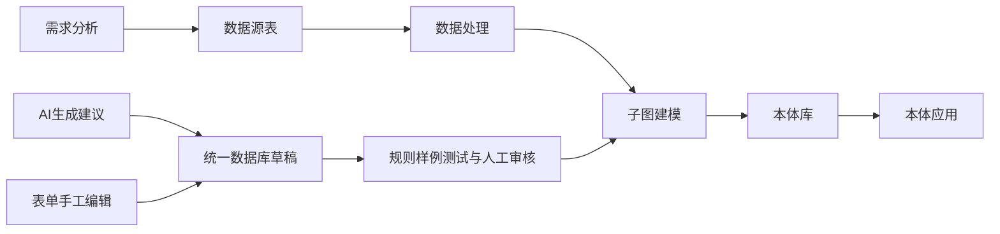

# 迭代进度与下一步

当前状态：**迭代 1 已完成开发与本地验收，待用户测试**。尚未推送 main，尚未更新生产环境。

| 迭代 | 内容 | 当前进度 / 验收标准 |
|---|---|---|
| 1：建模基础 | AI/手工共享草稿、已有对象复用、属性和关系编辑、规则依据/前提/例外、正反样例、审核记录、入库 | 已实现；80 项相关后端测试通过，浏览器实际操作通过；待用户验收 |
| 1：技术基线 | 24 项原依赖逐项分析、漏依赖补齐、部分关键版本锁定、通用提示词、草稿表迁移 | 已实现；旧数据库全量迁移规范化仍是后续工作 |
| 2：真实数据闭环 | 草稿关联交付项目、资产映射、规则作用范围、单位处理、实际实例验证、违规明细、版本发布 | 未开始本轮增量；复用已有数据/交付/发布模块 |
| 3：AI 业务应用 | 由已发布模型/查询生成技能、智能体工具调用、证据与执行记录、跨场景测试 | 原有技能/智能体增强代码已保留，后续与新草稿/规则版本整体验收 |
| 4：知识复用与标准验证 | 通用/行业知识包、RDF/OWL 交换能力评估、SHACL 等校验、权限与变更治理 | 待排期，按客户场景优先级实施 |

## 下一版详细范围

1. 在业务交付项目中关联本次建模草稿及已入库对象，避免两个入口互不相通。
2. 复用资产目录与映射管理，让 AI 建议“哪个字段映射哪个属性”，用户确认；记录来源、单位和转换规则。
3. 将规则适用前提从说明文字升级为可执行过滤条件；对缺失字段、单位冲突和不适用对象明确报告，不能假装验证通过。
4. 使用同一套约束定义验证真实实例，区分样例、抽样和全量校验；保存批次、规则版本、违规行及数据来源。
5. 将验证过的模型和规则版本纳入发布检查，再交给技能和智能体使用；对话答案能够回到实际查询证据。

第一条完整验收链路建议使用电商库存：需求“识别可用库存低于安全阈值的 SKU” → 商品/库存真实表 → 清洗单位与去重 → SKU/仓库/库存模型 → 规则验证与发布 → 问答调用库存技能。可以沿用现有供应链演示数据，避免重新开发另一套连接、数据或技能模块。

## 本轮验收证据与边界

- 后端：`test_modeling_drafts.py` 及已有交付、客户演示、行动、约束、影响分析测试合计 80 项通过。
- 浏览器：刷新后草稿保留、关系展示、规则正反样例、人工接受、入库、AI 建议预览与采纳均通过，无页面脚本异常。
- AI 浏览器验收使用本地协议模拟服务；不是生产 DeepSeek 实测。AI 输出结构、引用和错误保留行为另有接口测试。
- 前端 Vite 构建通过；仓库全量 `vue-tsc` 仍有历史类型错误，本次新增建模页及导航无类型诊断。本轮没有把全量类型检查标为通过。
- 依赖 `pip check` 通过；新增 Alembic 迁移覆盖空库、已有表与重复升级，尚未验证生产数据库。
- Docker Compose 隔离构建已尝试，但构建容器无法解析依赖镜像站域名，容器验收未完成；没有修改 ECS 或生产容器。
- 测试部署方式、操作清单和当前限制见 `iteration-1-testing.md`。
